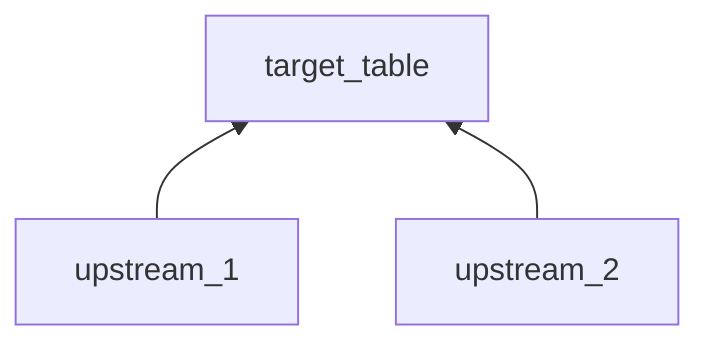
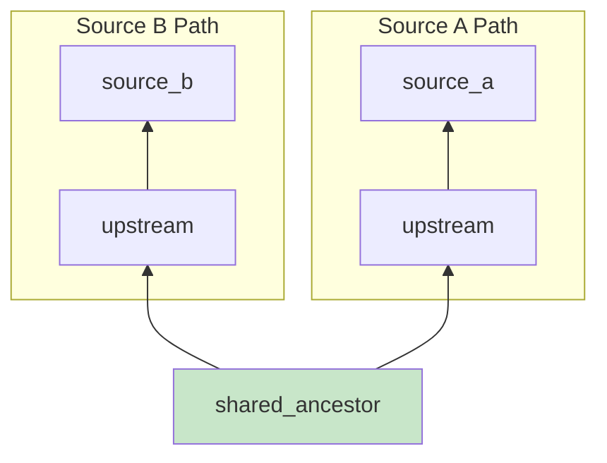

# Research

Trace lineage, review code, and complete research.md.

**Requires:** research.md with Project Map (from `/openspec-discover`)
**Completes:** research.md
**Next:** `/openspec-analyze`

---

## Execution model — MANDATORY

**SEQUENTIAL. ONE SOURCE AT A TIME.**

Do NOT process multiple sources in parallel.
Do NOT batch lineage calls for different sources.
Do NOT use parallel tool calls across sources.

**Why:** Each source's lineage may reveal shared ancestors with previous sources. Parallel execution loses this cross-source context.

**Sequence per source:** lineage first → code review second → update research.md → then next source.

---

## Read-only artifacts

**Do NOT modify context.md.** It captures the initial question and is the audit baseline.

If new context emerges during research, document it in research.md under "Additional Context".

---

## Steps

### Step 1: Load Project Map

Read research.md and list all sources from the Project Map.

If no change specified: auto-select if only one exists, otherwise ask.

### Step 2: Create Tasks for all sources

Create one Task per source from the Project Map:

```
For each source:
  TaskCreate:
    subject: "Research: <source_name>"
```

**SEQUENTIAL execution.** Process sources ONE AT A TIME in the order listed. Do NOT parallelize.

### Step 3: Research each source

For each Task:

1. `TaskUpdate: status → in_progress, activeForm → "Tracing lineage: <source_name>"`
2. Execute Step 3a
3. `TaskUpdate: activeForm → "Reviewing code: <source_name>"`
4. Execute Step 3b
5. `TaskUpdate: activeForm → "Updating research.md: <source_name>"`
6. Execute Step 3c
7. `TaskUpdate: status → completed`

**You MUST update activeForm before each phase.** Do NOT skip these updates.

#### Step 3a: Trace lineage

Invoke `/bigquery-lineage` in iterative mode (level by level):

```
Skill: /bigquery-lineage
Input: <FQDN>
```

**At each level, decide:** Which branches are relevant? Which can be skipped? When to stop?

**Linked datasets:** If output shows `# linked dataset: <target> -> <source>`:
- Document in research.md under "Linked Datasets"
- Target = project where data is consumed (via Analytics Hub)
- Source = project where data originates
- **Linked dataset = same data.** Not a copy, not synced — same underlying tables. Do NOT treat cross-project references as separate sources or discrepancy candidates.

**For discrepancies:** Trace EACH source independently. Find convergence (shared ancestor) or divergence (separate origins).

**For NEW dependencies found:** Invoke `/locate` to find code path, then add to Project Map.

#### Step 3b: Code review

Read the code fully:
- Field definitions relevant to the analysis
- Filters, WHERE clauses, JOIN conditions
- Business logic encoded in the source (SQL, LookML, Python, macros)

**For DBT models:** Also read the `.yml` definition in the same directory (column descriptions, tests). If no `.yml` exists, note it as a documentation gap.

If something is unclear: **STOP and ask user.** Do NOT assume.

#### Step 3c: Update research.md

After completing BOTH lineage and code review for this source, update:
- Source Registry entry
- Data Lineage section (Mermaid diagram)
- Code Review Findings

**Mark Task as completed. Then — and only then — start the next source.**

### Step 4: Complete research.md

After ALL sources are researched, fill remaining sections:

**Source Registry:**

| # | Type | Resource | Code Path | FQDN | Status | Key Contribution |
|---|------|----------|-----------|------|--------|------------------|

**Data Lineage** (per source, Mermaid flowchart):



**For discrepancies, show both paths:**



**Feasibility Verdict:**
- Feasible / Partially Feasible / Not Feasible
- Available now: ...
- Gaps: ...

If "Not Feasible": **STOP and discuss with user.**

---

## Constraints

- Do NOT modify context.md
- Do NOT parallelize across sources
- Do NOT infer business logic — read the code
- Do NOT skip lineage for discrepancy analysis
- Do NOT proceed past "Not Feasible" without user approval

---

## Output

Summarize:
- Sources researched: N
- Lineage depth reached
- Key findings
- Feasibility verdict

**Always end with:**
> "Research complete. Run `/openspec-analyze` when ready to execute."
